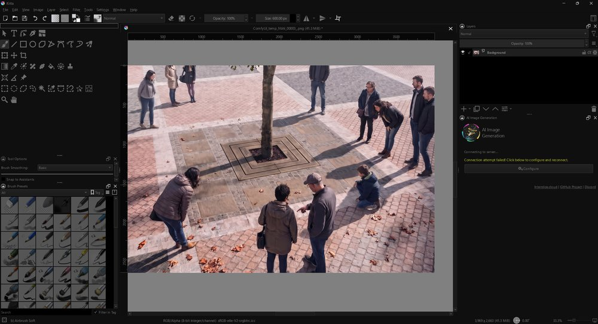

# Krita Dark

A very dark, low-contrast, pure-greyscale theme for Krita (darker than Photoshop's darkest), plus a plugin that dims Krita's bright white icons.

| Part | What it does |
|---|---|
| `color-schemes/PhotoshopDark.colors` | Greyscale color scheme: window 15, buttons 22, view/brush background black, soft text. Derived from Breeze Dark; no blue anywhere. |
| `pykrita/dark_icons` | Python plugin "Dark Icons": darkens all button/toolbar icons and the brush preset thumbnails (fixed light images the scheme can't recolor), and paints the window title bar/border dark (Windows 11). The installer also sets the canvas border (area around the image) to black. |

> [!WARNING]
> **Krita 5 and older: only the color scheme works.** The Dark Icons plugin needs **Krita 6** (PyQt6) and does not run on Krita 5 or 4. The installer detects your version and skips the plugin on older Krita; the icons, brush presets and title bar then stay bright. Krita 6 is a free download from krita.org.

**Tested on Krita 6.0.4, Windows 11.** The plugin is young - report problems as issues.

### Other versions
| | Krita 6.x | Krita 5.x / 4.x | Windows 10 |
|---|---|---|---|
| Color scheme | works | should work (same KDE `.colors` format; untested) | works |
| Dark Icons plugin | works | **no** - it needs PyQt6, older Krita ships PyQt5 | icons/presets yes, title bar color no |

On older Krita you can still use the color scheme alone: copy `color-schemes\PhotoshopDark.colors` to `%APPDATA%\krita\color-schemes\`.

## Install (Windows) - 3 steps
1. Download `krita-dark.zip` from Releases, right-click it > **Extract All**.
2. Double-click **INSTALL.bat** in the extracted folder. (If Windows warns, "More info" > "Run anyway".)
3. Start Krita. Done.

The installer asks you to close Krita if it's open, backs up your Krita settings first, copies everything, enables the plugin, selects the theme and checks that it worked. Any problem shows up as a clear red message and nothing is left half-broken.

### Undo
Double-click **UNINSTALL.bat**. It removes both parts and restores your old settings.

### Manual install
- Copy `color-schemes\PhotoshopDark.colors` to `%APPDATA%\krita\color-schemes\`
- Copy the contents of `pykrita\` to `%APPDATA%\krita\pykrita\`
- Krita: Settings > Configure Krita > Python Plugin Manager > enable **Dark Icons**; General > Themes > **Photoshop Dark**; restart.

## Tuning
- Title bar colors: `FRAME_COLOR` / `FRAME_TEXT`; brush preset darkness: `PRESET_DIM` (all at the top of `pykrita/dark_icons/__init__.py`).
- Icon darkness: `DIM` at the top of `pykrita/dark_icons/__init__.py` (0 = untouched, 255 = black; default 120). Restart Krita.
- Colors: edit the RGB triples in the `.colors` file (all grey: R=G=B).

## License
GPL-2.0-or-later (the scheme derives from KDE Breeze).
